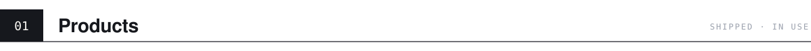
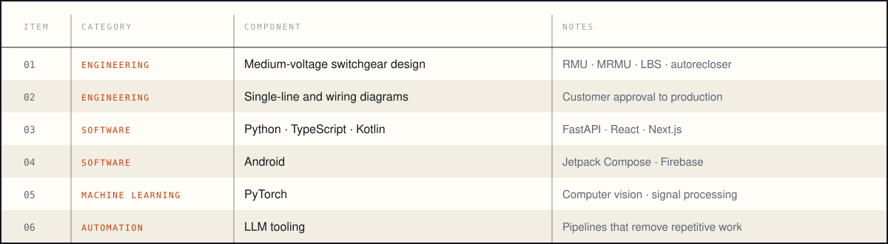

<a href="https://ahmadnayfeh.vercel.app"><picture><source media="(prefers-color-scheme: dark)" srcset="assets/hero-dark.svg"></picture></a>

  <a href="https://ahmadnayfeh.vercel.app"><b>Portfolio</b></a> &nbsp;·&nbsp;
  <a href="https://ahmadnayfeh.vercel.app/resume.pdf"><b>CV</b></a> &nbsp;·&nbsp;
  <a href="https://www.linkedin.com/in/ahmad-nayfeh2000/"><b>LinkedIn</b></a> &nbsp;·&nbsp;
  <a href="mailto:ahmadnayfeh2000@gmail.com"><b>Email</b></a>

 

<picture><source media="(prefers-color-scheme: dark)" srcset="assets/h-products-dark.svg"></picture>

  <a href="https://shadhra.app"><picture><source media="(prefers-color-scheme: dark)" srcset="assets/card-shadhra-dark.svg"></picture></a>
  <a href="https://ahmad-nayfeh.github.io/khatwa/"><picture><source media="(prefers-color-scheme: dark)" srcset="assets/card-khatwa-dark.svg"></picture></a>
  <a href="https://ahmad-nayfeh.github.io/marathon/"><picture><source media="(prefers-color-scheme: dark)" srcset="assets/card-marathon-dark.svg"></picture></a>

 

<picture><source media="(prefers-color-scheme: dark)" srcset="assets/h-research-dark.svg"></picture>

<picture><source media="(prefers-color-scheme: dark)" srcset="assets/research-dark.svg"></picture>

  <a href="https://github.com/Ahmad-Nayfeh/Distill-SSL">Distill-SSL</a> &nbsp;·&nbsp;
  <a href="https://github.com/Ahmad-Nayfeh/MRI-Tumor-Segmentation">MRI tumor segmentation</a> &nbsp;·&nbsp;
  <a href="https://github.com/Ahmad-Nayfeh/AI-Bearing-Diagnosis">Bearing fault diagnosis</a>

 

<picture><source media="(prefers-color-scheme: dark)" srcset="assets/h-toolbox-dark.svg"></picture>

<picture><source media="(prefers-color-scheme: dark)" srcset="assets/bom-dark.svg"></picture>

 

<picture><source media="(prefers-color-scheme: dark)" srcset="assets/footer-dark.svg"></picture>
