<a href="https://ahmadnayfeh.vercel.app"><picture><source media="(prefers-color-scheme: dark)" srcset="assets/hero-dark.svg"></picture></a>

  <a href="https://ahmadnayfeh.vercel.app"><b>Portfolio</b></a> &nbsp;·&nbsp;
  <a href="https://ahmadnayfeh.vercel.app/resume.pdf"><b>CV</b></a> &nbsp;·&nbsp;
  <a href="https://www.linkedin.com/in/ahmad-nayfeh2000/"><b>LinkedIn</b></a> &nbsp;·&nbsp;
  <a href="mailto:ahmadnayfeh2000@gmail.com"><b>Email</b></a>

 

<picture><source media="(prefers-color-scheme: dark)" srcset="assets/h-research-dark.svg">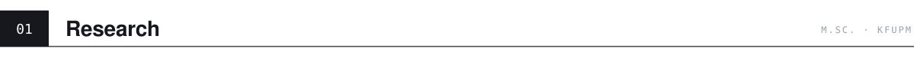</picture>

<picture><source media="(prefers-color-scheme: dark)" srcset="assets/research-dark.svg">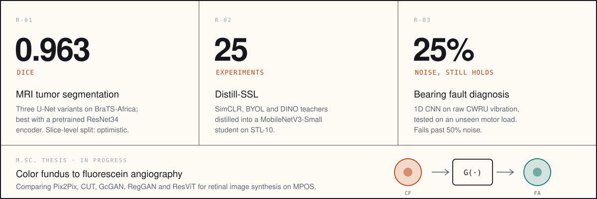</picture>

  <a href="https://github.com/Ahmad-Nayfeh/MRI-Tumor-Segmentation">MRI tumor segmentation</a> &nbsp;·&nbsp;
  <a href="https://github.com/Ahmad-Nayfeh/Distill-SSL">Distill-SSL</a> &nbsp;·&nbsp;
  <a href="https://github.com/Ahmad-Nayfeh/AI-Bearing-Diagnosis">Bearing fault diagnosis</a>

 

<picture><source media="(prefers-color-scheme: dark)" srcset="assets/h-lab-dark.svg">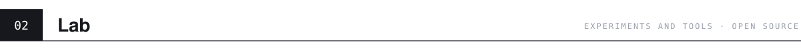</picture>

  <a href="https://github.com/Ahmad-Nayfeh/Digital-Image-Processing-Library"><picture><source media="(prefers-color-scheme: dark)" srcset="assets/lab-dip-lib-dark.svg">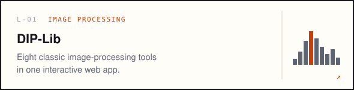</picture></a>
  <a href="https://github.com/Ahmad-Nayfeh/Frequency-Decomposition-Explorer"><picture><source media="(prefers-color-scheme: dark)" srcset="assets/lab-freq-dark.svg">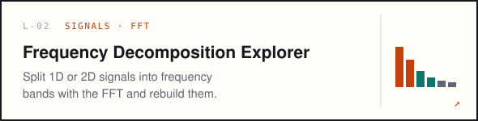</picture></a>

  <a href="https://github.com/Ahmad-Nayfeh/Edge-Vision"><picture><source media="(prefers-color-scheme: dark)" srcset="assets/lab-edge-dark.svg">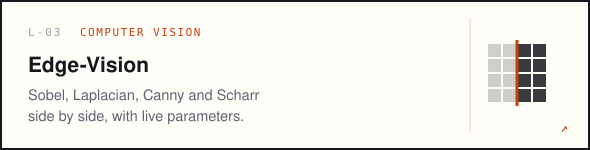</picture></a>
  <a href="https://github.com/Ahmad-Nayfeh/RL-Adaptive-Filtering-Pathfinding"><picture><source media="(prefers-color-scheme: dark)" srcset="assets/lab-adaptive-dark.svg">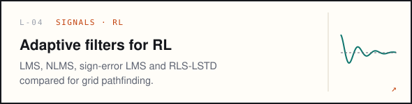</picture></a>

  <a href="https://github.com/Ahmad-Nayfeh/SimCLR-Augmentations-CIFAR10"><picture><source media="(prefers-color-scheme: dark)" srcset="assets/lab-simclr-dark.svg">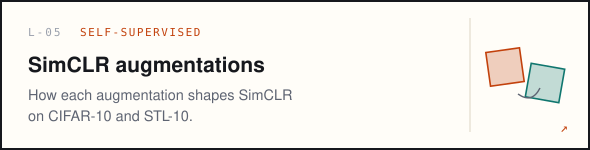</picture></a>
  <a href="https://github.com/Ahmad-Nayfeh/WindPowerForecasting-LSTM-RF"><picture><source media="(prefers-color-scheme: dark)" srcset="assets/lab-wind-dark.svg">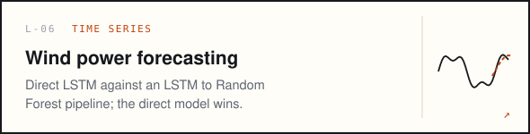</picture></a>

  <a href="https://github.com/Ahmad-Nayfeh/MNIST-CNN-Layer-Analysis"><picture><source media="(prefers-color-scheme: dark)" srcset="assets/lab-cnn-depth-dark.svg">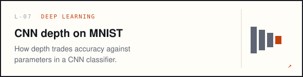</picture></a>
  <a href="https://github.com/Ahmad-Nayfeh/Modified-RDD2022-Dataset"><picture><source media="(prefers-color-scheme: dark)" srcset="assets/lab-rdd-dark.svg">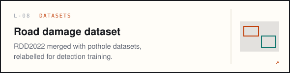</picture></a>

 

<picture><source media="(prefers-color-scheme: dark)" srcset="assets/h-apps-dark.svg">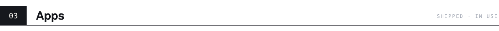</picture>

  <a href="https://shadhra.app"><picture><source media="(prefers-color-scheme: dark)" srcset="assets/card-shadhra-dark.svg">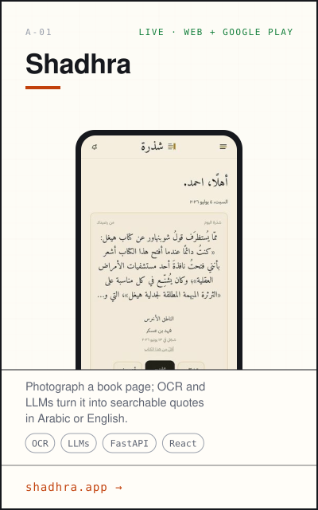</picture></a>
  <a href="https://ahmad-nayfeh.github.io/khatwa/"><picture><source media="(prefers-color-scheme: dark)" srcset="assets/card-khatwa-dark.svg">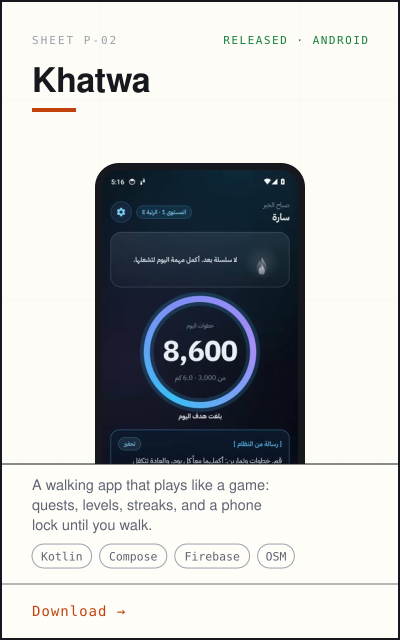</picture></a>
  <a href="https://ahmad-nayfeh.github.io/marathon/"><picture><source media="(prefers-color-scheme: dark)" srcset="assets/card-marathon-dark.svg">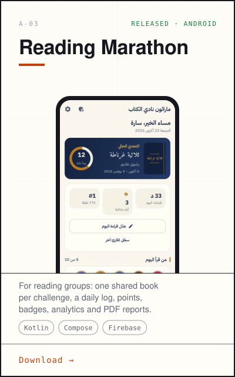</picture></a>

 

<picture><source media="(prefers-color-scheme: dark)" srcset="assets/h-stack-dark.svg">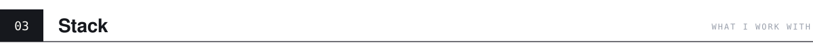</picture>

<picture><source media="(prefers-color-scheme: dark)" srcset="assets/stack-dark.svg">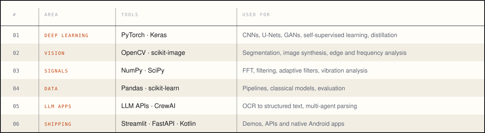</picture>

 

<picture><source media="(prefers-color-scheme: dark)" srcset="assets/footer-dark.svg">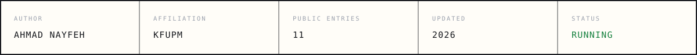</picture>
