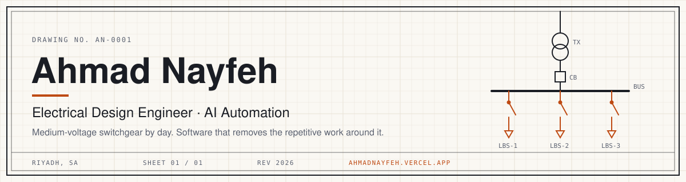

<a href="https://ahmadnayfeh.vercel.app">
  <picture>
    <source media="(prefers-color-scheme: dark)" srcset="assets/banner-dark.svg">
    
  </picture>
</a>

I design medium-voltage switchgear at Alfanar's Secondary Switchgear Factory (RMU, MRMU, LBS and autoreclosers), and I build the software that removes the repetitive work around it. Outside work I ship small, carefully made apps in Arabic.

[Portfolio](https://ahmadnayfeh.vercel.app) · [CV](https://ahmadnayfeh.vercel.app/resume.pdf) · [LinkedIn](https://www.linkedin.com/in/ahmad-nayfeh2000/) · [Email](mailto:ahmadnayfeh2000@gmail.com)

### Now

| | |
|:--|:--|
| **Working** | Electrical Design Engineer, Alfanar · Riyadh, since January 2026 |
| **Building** | Shadhra, Khatwa and Reading Marathon |
| **Studying** | M.Sc. in Electrical Engineering, KFUPM · thesis on retinal image synthesis |

### Products

| | | |
|:--|:--|:--|
| **[Shadhra](https://shadhra.app)** | Save quotes from printed books: photograph a page, extract the Arabic or English text, and resurface your library every day. FastAPI, React, Expo. | [Web](https://shadhra.app) · [Google Play](https://play.google.com/store/apps/details?id=app.shadhra) |
| **[Khatwa](https://ahmad-nayfeh.github.io/khatwa/)** | A walking app that plays like a game: daily quests, levels and streaks, an optional phone lock until you walk, and walk suggestions timed around weather and prayer times. Kotlin, Jetpack Compose. | [Download](https://ahmad-nayfeh.github.io/khatwa/) |
| **[Reading Marathon](https://ahmad-nayfeh.github.io/marathon/)** | For reading groups: one shared book per challenge, a daily reading log, points, badges, analytics and PDF reports. Kotlin, Jetpack Compose, Firebase. | [Download](https://ahmad-nayfeh.github.io/marathon/) |

### Research

- **[Distill-SSL](https://github.com/Ahmad-Nayfeh/Distill-SSL)**: 25 experiments on STL-10. SimCLR, BYOL and DINO teachers (ResNet-18) distilled into a MobileNetV3-Small student with single, ensemble and progressive strategies.
- **[MRI tumor segmentation](https://github.com/Ahmad-Nayfeh/MRI-Tumor-Segmentation)**: three U-Net variants on BraTS-Africa. 0.963 Dice with a pretrained ResNet34 encoder, measured on a slice-level split, so an optimistic estimate.
- **[Bearing fault diagnosis](https://github.com/Ahmad-Nayfeh/AI-Bearing-Diagnosis)**: a 1D CNN on raw CWRU vibration signals, tested on an unseen motor load and under added noise (holds at 25%, fails past 50%).

### Toolbox

- **Engineering:** medium-voltage switchgear design, single-line and wiring diagrams
- **Software:** Python, TypeScript, Kotlin, FastAPI, React, Next.js, Jetpack Compose, Firebase
- **Machine learning:** PyTorch, computer vision, signal processing, LLM tooling and automation
